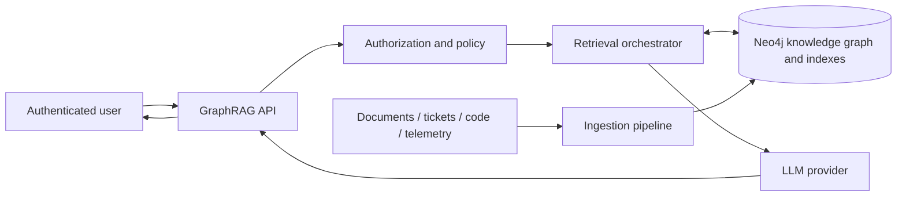
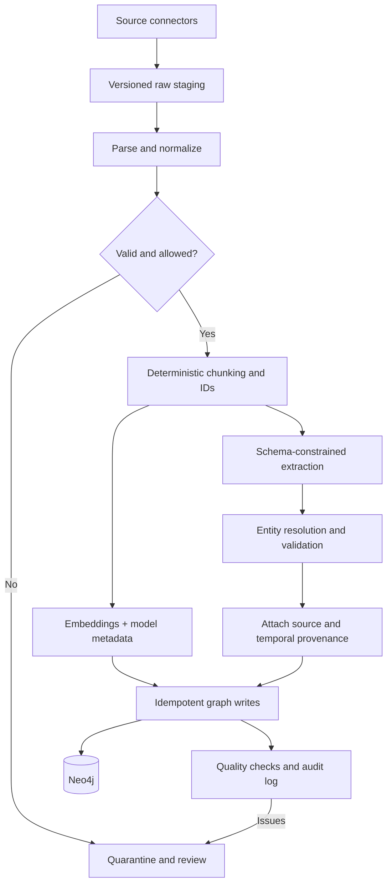
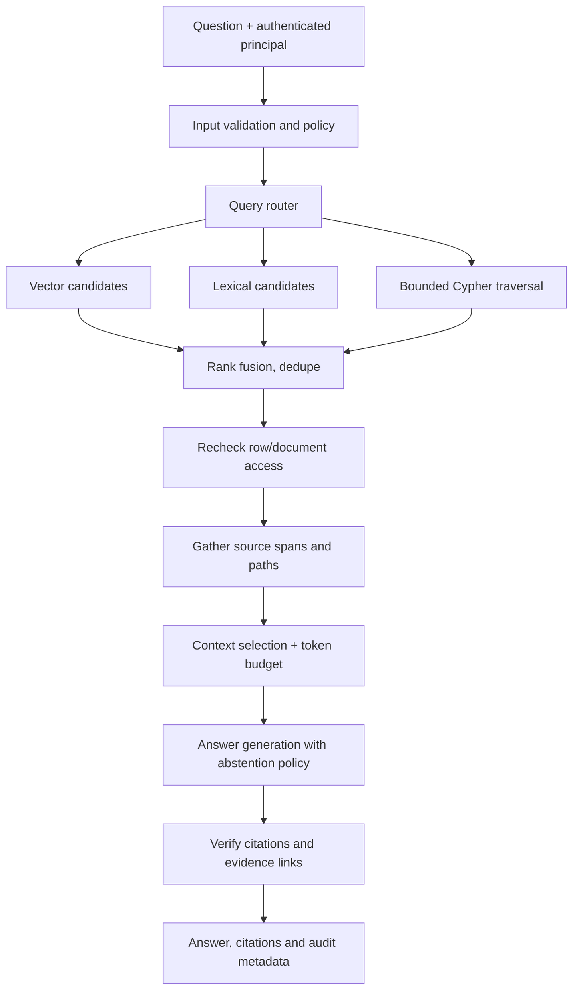
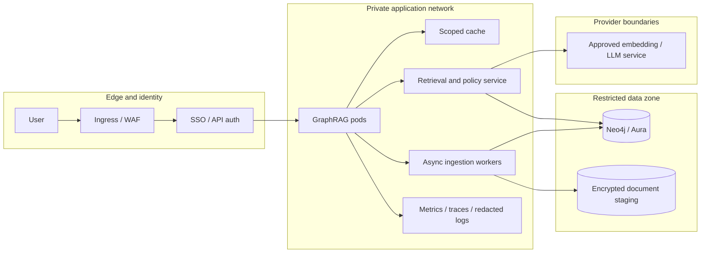
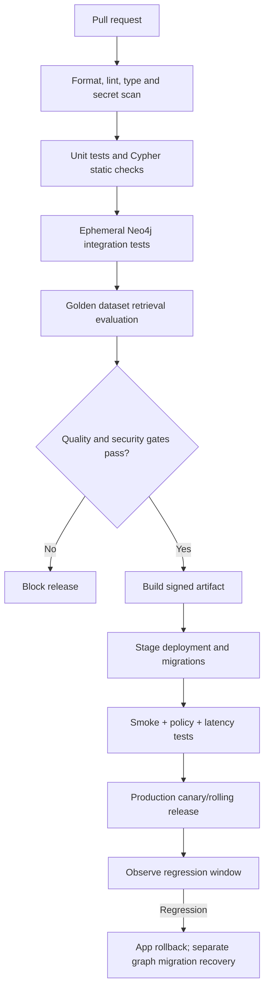
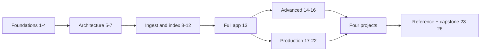

# The Neo4j GraphRAG Master Guide: Research, Coverage, Architecture and Roadmap

**Edition:** Initial researched build, 2026-10-21  
**Audience:** Python engineers, graph developers, ML/AI engineers, SRE/DevOps, architects and technical leads  
**Status:** Planning complete for the specified structure; Part I is authored; remaining chapters/projects require implementation and validation.

## Executive overview

A Retrieval-Augmented Generation (RAG) system answers questions using externally retrieved evidence. GraphRAG adds explicit entities, relationships, and graph-aware retrieval to address questions that depend on relationships between facts: dependencies, ownership, provenance, paths, impacts, and multi-hop evidence. It increases engineering burden and is not a universal quality upgrade. This guide teaches a defensible progression: lexical baseline -> vector baseline -> structured graph -> graph-enhanced retrieval -> evaluated, secure production system.

The book consistently distinguishes the *Neo4j database* (storage and query engine), the *neo4j-graphrag Python library* (retrievers, generation integration, and experimental pipelines), and custom orchestration code (authorization, routing, graph summaries, and operations). The reader will be able to identify what is provided directly and what must be engineered.

## Intended learning tracks

| Track | Starting point | Suggested route | Deliverable |
| --- | --- | --- | --- |
| Beginner | Can run Python, knows basic SQL | 1-4, 8-9, 13, 24, 26 | A working small graph and RAG prototype |
| Python/AI developer | Python and APIs | 2, 5-6, 8-18, 22 | Reproducible and evaluated RAG service |
| Graph developer | Cypher and Neo4j | 3-7, 10-16, 18-20 | Schema, extraction and traversal toolkit |
| DevOps/SRE | Containers, CI/CD, monitoring | 4-5, 17-22, Project 2 | Deployable, observable GraphRAG stack |
| Architect/tech lead | System design and risk | 1, 5-7, 18-23 | Technology selection and production gates |

## Detailed table of contents and coverage matrix

Status labels: `Authored` means substantial chapter text exists, **not** that a live database has been run; `Planned` means the chapter is not yet written. `Validation` identifies a meaningful acceptance or evidence target.

| Chapter | Mandatory coverage and primary questions | Hands-on / core output | Validation | Status |
| --- | --- | --- | --- | --- |
| 1. Introduction to GraphRAG | Definition, Neo4j role, vector-only and traditional RAG, KGs, long context, fine-tuning, ROI and tradeoffs | Selection decision tree and dependency question | Justified choice over baseline | Authored |
| 2. RAG Fundamentals | Tokens, embeddings, chunking, search, ranking, context, hallucinations and failures | Baseline retrieval pseudocode and metrics | Distinguish retrieval vs generation errors | Authored |
| 3. Graph Theory and Knowledge Graphs | Nodes, edges, labels, RDF/property graphs, schemas, resolution, temporal and provenance | Property-graph schema and traversal | Multi-hop paths and provenance checks | Authored |
| 4. Neo4j Fundamentals | Cypher, indexes, constraints, EXPLAIN/PROFILE, transactions, editions, backups | Docker + Python lab, schema and query tests | Repeatable seed, queries, offline tests | Authored |
| 5. Neo4j GraphRAG Architecture | Context, components, dataflows, async, tenancy | Reference architecture and boundaries | Trace evidence from source to answer | Planned |
| 6. Retrieval Strategies | Vector, lexical, hybrid, graph, multi-hop, rerank, custom tools | Retriever comparison lab | Relevance/latency/cost per method | Planned |
| 7. GraphRAG Design Patterns | Entity-linked docs, dependency, Text2Cypher, agentic and fallbacks | Design pattern catalog | Appropriate minimal strategy | Planned |
| 8. Environment Setup | Python/Neo4j/Aura, Docker, packages, TLS and failures | Reproducible dev environment | Install and smoke tests | Planned |
| 9. Python and Neo4j GraphRAG | Official API, provider adapters, driver, resource lifecycle | Verified minimal library example | API and integration tests | Planned |
| 10. Document Ingestion | PDF/Markdown/HTML/structured, IDs, chunking, CDC, reindex | Idempotent ingestion CLI | Dedupe, update, delete and retry tests | Planned |
| 11. Knowledge Graph Construction | Schema-guided extraction, resolution, factual provenance, contradictions | Extraction pipeline, human-review queue | Precision, coverage and provenance tests | Planned |
| 12. Embeddings and Vector Indexing | Dimensions, metrics, entity/chunk vectors, migrations | Vector and hybrid index creation | Dimension compatibility and quality | Planned |
| 13. Complete GraphRAG Application | Dataset, schema, two retrievers, citations, API/CLI, tests | Full application source tree | End-to-end verified answers | Planned |
| 14. Cypher for GraphRAG | Traversals, query planning, filters, read-only text2Cypher | Cypher safety and performance lab | No unbounded traversal or writes | Planned |
| 15. Hybrid and Multi-Stage Retrieval | Lexical/vector/graph fusion, RRF, reranking, budgets | Fusion retriever benchmark | Recall@k, nDCG, p95 | Planned |
| 16. Advanced Graph Reasoning | Multi-hop, impacts, graph communities and summaries | Multi-hop evidence chains | Every conclusion traceable | Planned |
| 17. API and App Integration | FastAPI, Pydantic, async, streaming, auth, quotas | Public/private API endpoints | Contract, load and auth tests | Planned |
| 18. Testing and Evaluation | Recall@k, MRR, nDCG, groundedness, judges, regression | Golden questions and eval runner | Controlled comparison to baselines | Planned |
| 19. Performance and Scale | Pooling, Cypher tuning, cache, batch, capacity and cost | k6/Locust-style test plan | Measured latency and throughput | Planned |
| 20. Security and Governance | ACL/RBAC, tenant isolation, injection, poisoning, deletion | Threat model and access tests | Cross-tenant zero exposure | Planned |
| 21. Deployment and DevOps | Compose, K8s, IaC, CI/CD, migrations, backup/restore, rollbacks | Deployment manifests and runbooks | Recovery rehearsal | Planned |
| 22. Observability and Troubleshooting | Traces, metrics, retrieval quality, model failures, incidents | Dashboards, alerts, RCA playbooks | Detection and incident exercises | Planned |
| 23. Comparison and Selection | Vector RAG vs graph, alternatives, managed/self-hosted, TCO | Vendor-neutral decision matrices | Decision trace to workload | Planned |
| 24. FAQ | >=30 questions on architecture, APIs and operations | Searchable FAQ | Fact/reference accuracy | Planned |
| 25. Glossary and Reference | Terminology, commands, official sources | Reference manual | Versioned commands and links | Planned |
| 26. Exercises and Capstone | Beginner to advanced tasks; capstone rubric | Exercises and acceptance checklist | Rubric-driven assessment | Planned |

### Part VI: Four mandatory implemented projects

| Project | Questions addressed | Data model | Core implementation | Verification | Status |
| --- | --- | --- | --- | --- | --- |
| 1. Enterprise Knowledge Assistant | What does a policy say, who owns it, and what version applies? | Document, Chunk, Entity, Team, Policy, Revision | Permission-aware ingest, hybrid and entity retrieval, evidence citations, API | ACL leakage, freshness, citation tests | Planned |
| 2. DevOps/SRE GraphRAG Assistant | What will fail if a service degrades? Which runbook applies? | Service, Cluster, Deployment, Alert, Incident, Runbook | Dependency traversal, temporal incidents, observability data adapter, question router | Impact path precision and operational tests | Planned |
| 3. Codebase and Architecture Assistant | Where is an API implemented and what depends on it? | Repository, File, Symbol, API, Module, Commit | Git incremental indexing, symbols, references, impact search | Staleness, commit consistency, precision tests | Planned |
| 4. Customer and Product Knowledge Graph | Which products, issues, and transactions are related? | Customer, Product, Order, SupportCase, Entity | Deduplication, sensitive-data controls, relationship search | Identity-resolution and privacy tests | Planned |

Each project must eventually include business requirements, diagrams, dataset design, full implementation, setup/configuration, sample output, automated tests, evaluation, security, deployment, troubleshooting and extensions. A design in this matrix is not equivalent to implemented source code.

## Research and version baseline

| Component | Verified current fact on 2026-10-21 | Implementation decision | Reason and caveat |
| --- | --- | --- | --- |
| Neo4j Database | 2026.10.0 released 2026-10-20 | Describe modern 2026.10.0 syntax | Very new release; production adoption requires release qualification |
| Local Docker lab | Official docs show `neo4j:2026.09.0` | Pin `neo4j:2026.09.0` in Lab 01 | Availability explicitly evidenced by official image documentation; newer image not verified here |
| `neo4j-graphrag` | PyPI latest verified 1.22.0 (2026-10-01) | Pin 1.22.0 when introduced in Part III | Official maintained package replaces `neo4j-genai` |
| Python | Python 3.15.0 released 2026-10-09 | Python 3.13 baseline | GraphRAG 1.22.0 requires >=3.10,<3.15; do not use 3.15 |
| Neo4j Python driver | GraphRAG 1.22.0 dependency >=6.3.1,<7 | `neo4j>=6.3.1,<7` for labs | Compatible major version, then generate hashed lock for final release |
| Cypher vector retrieval | `SEARCH` preferred since Neo4j 2026.01; `queryNodes` deprecated 2026.04 | `SEARCH` examples for modern 2026 server/Cypher 25 | Client helpers may internally abstract this difference; don't promise internal query plans |
| Full-text retrieval | `SEARCH` available since 2026.09 (Cypher 25); procedure still available | Document both with version labels | Full-text and vector relevance scores not directly comparable |
| KG Builder | Official docs explicitly say experimental | Isolate behind adapter; pin and test | Schema/extraction APIs may change |
| Generated Cypher | `Text2CypherRetriever` is exposed in official API | Default to controlled queries; LLM-generated Cypher only after safety gate | Don't assume automatic read-only proof/ACL compliance |

### Source verification procedure

1. On each release, read Neo4j [release notes](https://neo4j.com/release-notes/) and [operations manual](https://neo4j.com/docs/operations-manual/current/).
2. Check the exact package release on [PyPI](https://pypi.org/project/neo4j-graphrag/) and the matching tag/`pyproject.toml` in [GitHub](https://github.com/neo4j/neo4j-graphrag-python).
3. Check [GraphRAG API](https://neo4j.com/docs/neo4j-graphrag-python/current/api.html), [RAG user guide](https://neo4j.com/docs/neo4j-graphrag-python/current/user_guide_rag.html), and [KG Builder guide](https://neo4j.com/docs/neo4j-graphrag-python/current/user_guide_kg_builder.html) before changing imports or parameters.
4. Check version-specific Cypher behavior in the [Cypher manual](https://neo4j.com/docs/cypher-manual/current/) and Python driver usage in the [driver manual](https://neo4j.com/docs/python-manual/current/).
5. Capture environment versions, lock hashes, migration notes, E2E logs and reference-access date with each example revision.
6. Classify every claim: **Documented**, **Executed**, **Expected sample**, **Design recommendation**, or **Requires verification**.
7. Treat dependencies, license options, external API prices and managed-product privileges as time-varying. Recheck before publishing the final edition.

## Unified domain model and design decisions

The examples throughout the book will share a fictional company called **Northstar Labs**, whose synthetic service inventory, policies, runbooks and incidents provide both textual and relational information. This avoids mixing unrelated schema names between chapters.

The core graph will progressively introduce these labels and relationships:

| Element | Key fields | Relationships / purpose |
| --- | --- | --- |
| `Document` | `id`, `tenant_id`, `uri`, `version`, `classification` | `HAS_CHUNK`, `OWNED_BY`; source lifecycle |
| `Chunk` | `id`, `document_id`, `text`, `position`, `embedding_model`, `embedding` | `MENTIONS`, `SUPPORTS`; retrievable evidence |
| `Entity` | `id`, `canonical_name`, `type`, `tenant_id` | `MENTIONS` target; resolution and linking |
| `Fact` | `id`, `claim`, `valid_from`, `valid_to`, `source_confidence` | `SUPPORTS`; explicit provenance |
| `Service` | `id`, `name`, `environment`, `tenant_id` | `DEPENDS_ON`, `DEPLOYED_TO`, `OWNED_BY` |
| `Incident` | `id`, `title`, `severity`, `occurred_at` | `AFFECTED`, `EXPLAINED_BY` |
| `Runbook` | `id`, `title`, `version` | `MITIGATES`, `OWNED_BY` |
| `Team` | `id`, `name` | service/document ownership |

Design commitments:

- **Stable IDs:** source-specific IDs and namespaced tenant IDs; never use LLM-generated names as unique keys by themselves.
- **Graph semantics:** edge direction encodes meaning, e.g. `(Checkout)-[:DEPENDS_ON]->(Payments)` means Checkout depends on Payments.
- **Provenance:** a generated statement needs a source ID, source version, document span or graph relation, and ingestion timestamp when relevant.
- **Time:** separate event time, valid time and ingestion time where needed. Do not treat the current graph as automatically correct for historical questions.
- **ACL and tenancy:** enforce authorization before evidence reaches the model. Cross-tenant fan-out is forbidden unless explicitly authorized by application policy.
- **Index compatibility:** embedder model and dimensions travel with index metadata. Changing models may require re-embedding and index rebuild.
- **Query control:** use parameterized Cypher; bound depth, rows and timeout. Read-only credentials and database-policy enforcement are required before allowing generated queries.
- **Evidence handling:** treat documents, graph properties and tool results as untrusted data rather than executable instructions.
- **Evaluation:** benchmark simple lexical/vector baselines before adding multi-hop or agentic complexity.
- **Observability:** measure retrieval recall, precision, groundedness, citation validity, query latency, model cost and tenant-policy violations separately.

## Reference architecture

### 1. System context

The API is the policy enforcement point; LLM input is limited to authorized evidence. Retrieval methods are pluggable and independently evaluated.

### 2. Data ingestion and knowledge-graph construction

Quarantining extraction is not the same as deleting source data. Removal and reindexing need separate reconciliation and propagation controls.

### 3. Query-time retrieval, evidence assembly and generation

The diagram depicts the full reference design. Initial chapters implement progressively simpler variants and never imply that an unimplemented step is automatic.

### 4. Production topology and security boundaries

A diagram is not proof of security: production must validate network access, role privileges, retrieval ACLs, redaction, backup encryption, deletion, and provider data-handling terms.

### 5. CI/CD and rollback design

Schema/data rollback may require explicit migrations and backup restoration; a rolling application rollback alone is not a graph-data rollback.

## Retrieval strategy decision matrix

| Strategy | Strong at | Weak at / risks | When to prefer |
| --- | --- | --- | --- |
| Full-text / lexical | Exact terms, error messages, IDs | Synonyms, indirect relationships | Identifiers, alerts, code names |
| Vector-only | Semantic paraphrases and fuzzy matching | Multi-hop relation accuracy, model drift | FAQ-like questions, descriptive text |
| Hybrid lexical + vector | Balances terms and semantics | Fusion calibration and cost | Mixed technical corpus |
| Structured Cypher | Deterministic relationships, path counts, bounded joins | Needs reliable schema and correct query | Ownership, dependency and topology |
| Vector + graph neighborhood | Semantic entry point plus linked context | High-degree fanout, irrelevant neighbors | Evidence spans joined to entities |
| Generated Cypher | Flexible NL-to-structured query | Injection, incorrect queries, ACL leakage | Approved read-only schemas with validation |
| Agentic/multi-stage | Complex decomposable questions | More latency, cost and unpredictability | Demonstrated hard cases after baseline tests |

These are engineering expectations, not measured benchmark findings. Chapter 18 will establish a reproducible comparison process.

## Implementation roadmap and dependencies

| Stage | Chapters / project | Explicit deliverables | Exit gate |
| --- | --- | --- | --- |
| 0. Research and foundations | Plan, 1-4 | Research ledger; graph fundamentals; Lab 01 | Structural review and safe local starter |
| 1. Retrieval architecture | 5-7 | Routing contract, context/citation schema, reference patterns | Threat and data-flow review |
| 2. Reproducible data pipeline | 8-12 | Version-locked environment, parsers, extractor, indexes | Ingestion determinism, schema and index tests |
| 3. Working service | 13-16 | Two+ retrievers, API/CLI, safe bounded Cypher, rerank | Golden questions and end-to-end tests |
| 4. Production controls | 17-22 | Auth, tests, load suite, deployment, runbooks, dashboards | Security and recovery rehearsals |
| 5. Four projects | Project 1-4 | Each full implementation in separate folder | Project-specific acceptance tests |
| 6. Mastery and audit | 23-26 | 30+ FAQs, glossary, exercises, capstone, audit | No placeholders or unsupported claims |

Dependency graph:

### Project-specific implementation dependencies

- Enterprise assistant: Source and ACL adapters, document provenance, hybrid search, policy evaluation, citation rendering and freshness tests.
- DevOps/SRE assistant: Service topology schema, incident/event timestamps, source connector mocks, bounded impact queries, hallucination-resisting runbook responses and non-production datasets.
- Codebase assistant: Git commit ID indexing, language parser adapters, file path stability, symbol resolution, incremental commit diff handling and race controls.
- Customer/product assistant: Entity identity policy, sensitive field minimization, retention/erasure logic, purchase/support relationship schema and restricted-answer tests.

## Quality gates and audit scorecard

| Category | Required proof before a final Gold Standard claim | Current status |
| --- | --- | --- |
| 26 chapters | All mandatory subjects and required chapter sections | Part I authored; remainder planned |
| Four projects | Complete source, tests, outputs, deploy/runbooks | Not implemented |
| API accuracy | Package-version-pinned API and import tests | Official docs verified; execution pending |
| Code reproducibility | Local/CI tests run against exact DB version | Lab files present; DB integration pending |
| Knowledge quality | Extraction precision, provenance, source spans | Design established; evaluation pending |
| Retrieval quality | Baselines, golden dataset, Recall@k/MRR/nDCG | Method established; measures pending |
| Security | Tenant-isolation, injection, privilege and deletion tests | Threat model design established; testing pending |
| Deployment | K8s/Compose and recovery exercises | Architecture only |
| References | First-party sources and verified freshness | Initial source ledger complete |
| Diagrams | Architecture matches executable source | Planning diagrams consistent; runtime pending |

## Editorial and test policy

Every authored chapter uses learning objectives; why it matters; terminology; explanation; examples/code where relevant; verification and expected outcomes; mistakes; security; best practices; exercises; sources. Implementation chapters will additionally state file paths, dependency versions, setup, test commands, external provider costs, and code/test status.

Every part closure records what was authored, technical choices, files, unresolved verifications and the exact next chapter. A completion claim applies only to content that has actually been written and tested to the stated level.
