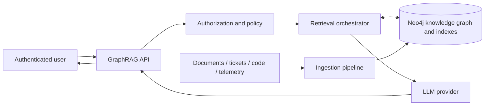
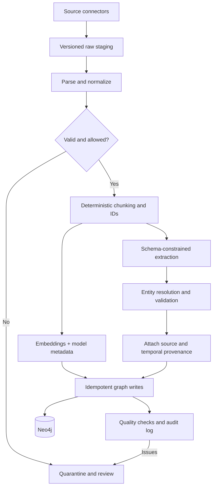
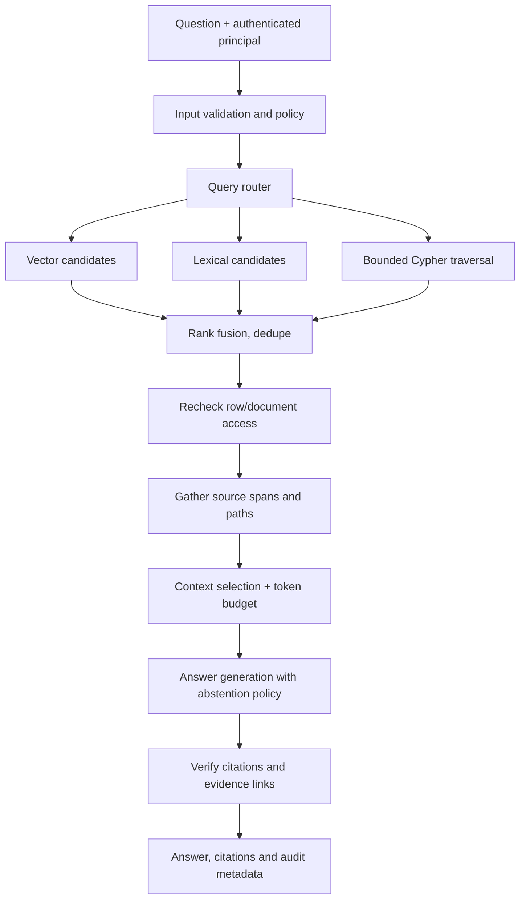
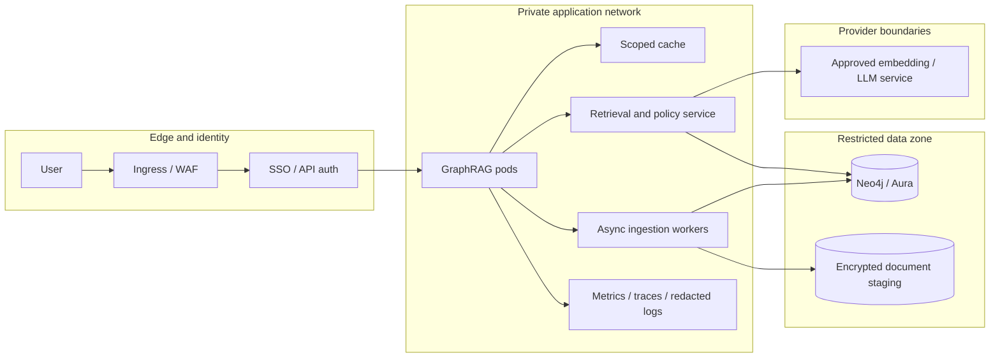
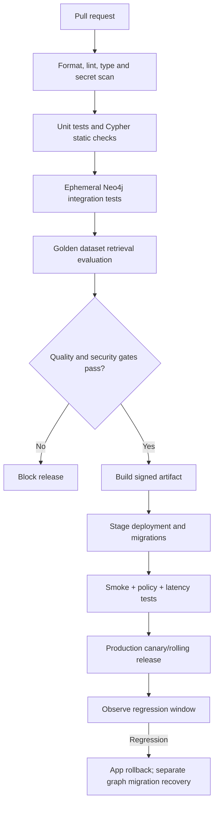
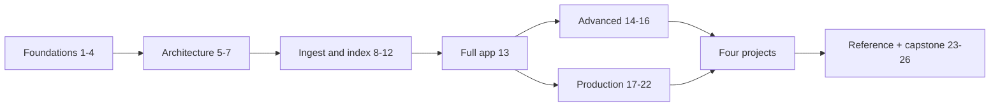
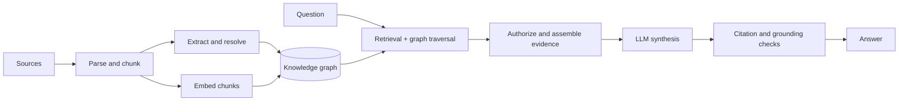
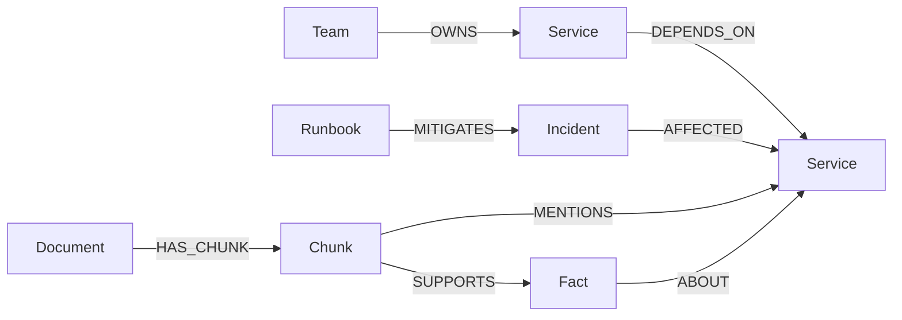

# Neo4j GraphRAG Master Guide - Volume 1

**Research and authoring date: October 21, 2026.** This single-file edition combines the research plan and Chapters 1-4. The executable Lab 01 is in the ZIP archive. Later chapters are planned but not yet written.


---

# The Neo4j GraphRAG Master Guide: Research, Coverage, Architecture and Roadmap

**Edition:** Initial researched build, 2026-10-21  
**Audience:** Python engineers, graph developers, ML/AI engineers, SRE/DevOps, architects and technical leads  
**Status:** Planning complete for the specified structure; Part I is authored; remaining chapters/projects require implementation and validation.

## Executive overview

A Retrieval-Augmented Generation (RAG) system answers questions using externally retrieved evidence. GraphRAG adds explicit entities, relationships, and graph-aware retrieval to address questions that depend on relationships between facts: dependencies, ownership, provenance, paths, impacts, and multi-hop evidence. It increases engineering burden and is not a universal quality upgrade. This guide teaches a defensible progression: lexical baseline -> vector baseline -> structured graph -> graph-enhanced retrieval -> evaluated, secure production system.

The book consistently distinguishes the *Neo4j database* (storage and query engine), the *neo4j-graphrag Python library* (retrievers, generation integration, and experimental pipelines), and custom orchestration code (authorization, routing, graph summaries, and operations). The reader will be able to identify what is provided directly and what must be engineered.

## Intended learning tracks

| Track | Starting point | Suggested route | Deliverable |
| --- | --- | --- | --- |
| Beginner | Can run Python, knows basic SQL | 1-4, 8-9, 13, 24, 26 | A working small graph and RAG prototype |
| Python/AI developer | Python and APIs | 2, 5-6, 8-18, 22 | Reproducible and evaluated RAG service |
| Graph developer | Cypher and Neo4j | 3-7, 10-16, 18-20 | Schema, extraction and traversal toolkit |
| DevOps/SRE | Containers, CI/CD, monitoring | 4-5, 17-22, Project 2 | Deployable, observable GraphRAG stack |
| Architect/tech lead | System design and risk | 1, 5-7, 18-23 | Technology selection and production gates |

## Detailed table of contents and coverage matrix

Status labels: `Authored` means substantial chapter text exists, **not** that a live database has been run; `Planned` means the chapter is not yet written. `Validation` identifies a meaningful acceptance or evidence target.

| Chapter | Mandatory coverage and primary questions | Hands-on / core output | Validation | Status |
| --- | --- | --- | --- | --- |
| 1. Introduction to GraphRAG | Definition, Neo4j role, vector-only and traditional RAG, KGs, long context, fine-tuning, ROI and tradeoffs | Selection decision tree and dependency question | Justified choice over baseline | Authored |
| 2. RAG Fundamentals | Tokens, embeddings, chunking, search, ranking, context, hallucinations and failures | Baseline retrieval pseudocode and metrics | Distinguish retrieval vs generation errors | Authored |
| 3. Graph Theory and Knowledge Graphs | Nodes, edges, labels, RDF/property graphs, schemas, resolution, temporal and provenance | Property-graph schema and traversal | Multi-hop paths and provenance checks | Authored |
| 4. Neo4j Fundamentals | Cypher, indexes, constraints, EXPLAIN/PROFILE, transactions, editions, backups | Docker + Python lab, schema and query tests | Repeatable seed, queries, offline tests | Authored |
| 5. Neo4j GraphRAG Architecture | Context, components, dataflows, async, tenancy | Reference architecture and boundaries | Trace evidence from source to answer | Planned |
| 6. Retrieval Strategies | Vector, lexical, hybrid, graph, multi-hop, rerank, custom tools | Retriever comparison lab | Relevance/latency/cost per method | Planned |
| 7. GraphRAG Design Patterns | Entity-linked docs, dependency, Text2Cypher, agentic and fallbacks | Design pattern catalog | Appropriate minimal strategy | Planned |
| 8. Environment Setup | Python/Neo4j/Aura, Docker, packages, TLS and failures | Reproducible dev environment | Install and smoke tests | Planned |
| 9. Python and Neo4j GraphRAG | Official API, provider adapters, driver, resource lifecycle | Verified minimal library example | API and integration tests | Planned |
| 10. Document Ingestion | PDF/Markdown/HTML/structured, IDs, chunking, CDC, reindex | Idempotent ingestion CLI | Dedupe, update, delete and retry tests | Planned |
| 11. Knowledge Graph Construction | Schema-guided extraction, resolution, factual provenance, contradictions | Extraction pipeline, human-review queue | Precision, coverage and provenance tests | Planned |
| 12. Embeddings and Vector Indexing | Dimensions, metrics, entity/chunk vectors, migrations | Vector and hybrid index creation | Dimension compatibility and quality | Planned |
| 13. Complete GraphRAG Application | Dataset, schema, two retrievers, citations, API/CLI, tests | Full application source tree | End-to-end verified answers | Planned |
| 14. Cypher for GraphRAG | Traversals, query planning, filters, read-only text2Cypher | Cypher safety and performance lab | No unbounded traversal or writes | Planned |
| 15. Hybrid and Multi-Stage Retrieval | Lexical/vector/graph fusion, RRF, reranking, budgets | Fusion retriever benchmark | Recall@k, nDCG, p95 | Planned |
| 16. Advanced Graph Reasoning | Multi-hop, impacts, graph communities and summaries | Multi-hop evidence chains | Every conclusion traceable | Planned |
| 17. API and App Integration | FastAPI, Pydantic, async, streaming, auth, quotas | Public/private API endpoints | Contract, load and auth tests | Planned |
| 18. Testing and Evaluation | Recall@k, MRR, nDCG, groundedness, judges, regression | Golden questions and eval runner | Controlled comparison to baselines | Planned |
| 19. Performance and Scale | Pooling, Cypher tuning, cache, batch, capacity and cost | k6/Locust-style test plan | Measured latency and throughput | Planned |
| 20. Security and Governance | ACL/RBAC, tenant isolation, injection, poisoning, deletion | Threat model and access tests | Cross-tenant zero exposure | Planned |
| 21. Deployment and DevOps | Compose, K8s, IaC, CI/CD, migrations, backup/restore, rollbacks | Deployment manifests and runbooks | Recovery rehearsal | Planned |
| 22. Observability and Troubleshooting | Traces, metrics, retrieval quality, model failures, incidents | Dashboards, alerts, RCA playbooks | Detection and incident exercises | Planned |
| 23. Comparison and Selection | Vector RAG vs graph, alternatives, managed/self-hosted, TCO | Vendor-neutral decision matrices | Decision trace to workload | Planned |
| 24. FAQ | >=30 questions on architecture, APIs and operations | Searchable FAQ | Fact/reference accuracy | Planned |
| 25. Glossary and Reference | Terminology, commands, official sources | Reference manual | Versioned commands and links | Planned |
| 26. Exercises and Capstone | Beginner to advanced tasks; capstone rubric | Exercises and acceptance checklist | Rubric-driven assessment | Planned |

### Part VI: Four mandatory implemented projects

| Project | Questions addressed | Data model | Core implementation | Verification | Status |
| --- | --- | --- | --- | --- | --- |
| 1. Enterprise Knowledge Assistant | What does a policy say, who owns it, and what version applies? | Document, Chunk, Entity, Team, Policy, Revision | Permission-aware ingest, hybrid and entity retrieval, evidence citations, API | ACL leakage, freshness, citation tests | Planned |
| 2. DevOps/SRE GraphRAG Assistant | What will fail if a service degrades? Which runbook applies? | Service, Cluster, Deployment, Alert, Incident, Runbook | Dependency traversal, temporal incidents, observability data adapter, question router | Impact path precision and operational tests | Planned |
| 3. Codebase and Architecture Assistant | Where is an API implemented and what depends on it? | Repository, File, Symbol, API, Module, Commit | Git incremental indexing, symbols, references, impact search | Staleness, commit consistency, precision tests | Planned |
| 4. Customer and Product Knowledge Graph | Which products, issues, and transactions are related? | Customer, Product, Order, SupportCase, Entity | Deduplication, sensitive-data controls, relationship search | Identity-resolution and privacy tests | Planned |

Each project must eventually include business requirements, diagrams, dataset design, full implementation, setup/configuration, sample output, automated tests, evaluation, security, deployment, troubleshooting and extensions. A design in this matrix is not equivalent to implemented source code.

## Research and version baseline

| Component | Verified current fact on 2026-10-21 | Implementation decision | Reason and caveat |
| --- | --- | --- | --- |
| Neo4j Database | 2026.10.0 released 2026-10-20 | Describe modern 2026.10.0 syntax | Very new release; production adoption requires release qualification |
| Local Docker lab | Official docs show `neo4j:2026.09.0` | Pin `neo4j:2026.09.0` in Lab 01 | Availability explicitly evidenced by official image documentation; newer image not verified here |
| `neo4j-graphrag` | PyPI latest verified 1.22.0 (2026-10-01) | Pin 1.22.0 when introduced in Part III | Official maintained package replaces `neo4j-genai` |
| Python | Python 3.15.0 released 2026-10-09 | Python 3.13 baseline | GraphRAG 1.22.0 requires >=3.10,<3.15; do not use 3.15 |
| Neo4j Python driver | GraphRAG 1.22.0 dependency >=6.3.1,<7 | `neo4j>=6.3.1,<7` for labs | Compatible major version, then generate hashed lock for final release |
| Cypher vector retrieval | `SEARCH` preferred since Neo4j 2026.01; `queryNodes` deprecated 2026.04 | `SEARCH` examples for modern 2026 server/Cypher 25 | Client helpers may internally abstract this difference; don't promise internal query plans |
| Full-text retrieval | `SEARCH` available since 2026.09 (Cypher 25); procedure still available | Document both with version labels | Full-text and vector relevance scores not directly comparable |
| KG Builder | Official docs explicitly say experimental | Isolate behind adapter; pin and test | Schema/extraction APIs may change |
| Generated Cypher | `Text2CypherRetriever` is exposed in official API | Default to controlled queries; LLM-generated Cypher only after safety gate | Don't assume automatic read-only proof/ACL compliance |

### Source verification procedure

1. On each release, read Neo4j [release notes](https://neo4j.com/release-notes/) and [operations manual](https://neo4j.com/docs/operations-manual/current/).
2. Check the exact package release on [PyPI](https://pypi.org/project/neo4j-graphrag/) and the matching tag/`pyproject.toml` in [GitHub](https://github.com/neo4j/neo4j-graphrag-python).
3. Check [GraphRAG API](https://neo4j.com/docs/neo4j-graphrag-python/current/api.html), [RAG user guide](https://neo4j.com/docs/neo4j-graphrag-python/current/user_guide_rag.html), and [KG Builder guide](https://neo4j.com/docs/neo4j-graphrag-python/current/user_guide_kg_builder.html) before changing imports or parameters.
4. Check version-specific Cypher behavior in the [Cypher manual](https://neo4j.com/docs/cypher-manual/current/) and Python driver usage in the [driver manual](https://neo4j.com/docs/python-manual/current/).
5. Capture environment versions, lock hashes, migration notes, E2E logs and reference-access date with each example revision.
6. Classify every claim: **Documented**, **Executed**, **Expected sample**, **Design recommendation**, or **Requires verification**.
7. Treat dependencies, license options, external API prices and managed-product privileges as time-varying. Recheck before publishing the final edition.

## Unified domain model and design decisions

The examples throughout the book will share a fictional company called **Northstar Labs**, whose synthetic service inventory, policies, runbooks and incidents provide both textual and relational information. This avoids mixing unrelated schema names between chapters.

The core graph will progressively introduce these labels and relationships:

| Element | Key fields | Relationships / purpose |
| --- | --- | --- |
| `Document` | `id`, `tenant_id`, `uri`, `version`, `classification` | `HAS_CHUNK`, `OWNED_BY`; source lifecycle |
| `Chunk` | `id`, `document_id`, `text`, `position`, `embedding_model`, `embedding` | `MENTIONS`, `SUPPORTS`; retrievable evidence |
| `Entity` | `id`, `canonical_name`, `type`, `tenant_id` | `MENTIONS` target; resolution and linking |
| `Fact` | `id`, `claim`, `valid_from`, `valid_to`, `source_confidence` | `SUPPORTS`; explicit provenance |
| `Service` | `id`, `name`, `environment`, `tenant_id` | `DEPENDS_ON`, `DEPLOYED_TO`, `OWNED_BY` |
| `Incident` | `id`, `title`, `severity`, `occurred_at` | `AFFECTED`, `EXPLAINED_BY` |
| `Runbook` | `id`, `title`, `version` | `MITIGATES`, `OWNED_BY` |
| `Team` | `id`, `name` | service/document ownership |

Design commitments:

- **Stable IDs:** source-specific IDs and namespaced tenant IDs; never use LLM-generated names as unique keys by themselves.
- **Graph semantics:** edge direction encodes meaning, e.g. `(Checkout)-[:DEPENDS_ON]->(Payments)` means Checkout depends on Payments.
- **Provenance:** a generated statement needs a source ID, source version, document span or graph relation, and ingestion timestamp when relevant.
- **Time:** separate event time, valid time and ingestion time where needed. Do not treat the current graph as automatically correct for historical questions.
- **ACL and tenancy:** enforce authorization before evidence reaches the model. Cross-tenant fan-out is forbidden unless explicitly authorized by application policy.
- **Index compatibility:** embedder model and dimensions travel with index metadata. Changing models may require re-embedding and index rebuild.
- **Query control:** use parameterized Cypher; bound depth, rows and timeout. Read-only credentials and database-policy enforcement are required before allowing generated queries.
- **Evidence handling:** treat documents, graph properties and tool results as untrusted data rather than executable instructions.
- **Evaluation:** benchmark simple lexical/vector baselines before adding multi-hop or agentic complexity.
- **Observability:** measure retrieval recall, precision, groundedness, citation validity, query latency, model cost and tenant-policy violations separately.

## Reference architecture

### 1. System context



The API is the policy enforcement point; LLM input is limited to authorized evidence. Retrieval methods are pluggable and independently evaluated.

### 2. Data ingestion and knowledge-graph construction



Quarantining extraction is not the same as deleting source data. Removal and reindexing need separate reconciliation and propagation controls.

### 3. Query-time retrieval, evidence assembly and generation



The diagram depicts the full reference design. Initial chapters implement progressively simpler variants and never imply that an unimplemented step is automatic.

### 4. Production topology and security boundaries



A diagram is not proof of security: production must validate network access, role privileges, retrieval ACLs, redaction, backup encryption, deletion, and provider data-handling terms.

### 5. CI/CD and rollback design



Schema/data rollback may require explicit migrations and backup restoration; a rolling application rollback alone is not a graph-data rollback.

## Retrieval strategy decision matrix

| Strategy | Strong at | Weak at / risks | When to prefer |
| --- | --- | --- | --- |
| Full-text / lexical | Exact terms, error messages, IDs | Synonyms, indirect relationships | Identifiers, alerts, code names |
| Vector-only | Semantic paraphrases and fuzzy matching | Multi-hop relation accuracy, model drift | FAQ-like questions, descriptive text |
| Hybrid lexical + vector | Balances terms and semantics | Fusion calibration and cost | Mixed technical corpus |
| Structured Cypher | Deterministic relationships, path counts, bounded joins | Needs reliable schema and correct query | Ownership, dependency and topology |
| Vector + graph neighborhood | Semantic entry point plus linked context | High-degree fanout, irrelevant neighbors | Evidence spans joined to entities |
| Generated Cypher | Flexible NL-to-structured query | Injection, incorrect queries, ACL leakage | Approved read-only schemas with validation |
| Agentic/multi-stage | Complex decomposable questions | More latency, cost and unpredictability | Demonstrated hard cases after baseline tests |

These are engineering expectations, not measured benchmark findings. Chapter 18 will establish a reproducible comparison process.

## Implementation roadmap and dependencies

| Stage | Chapters / project | Explicit deliverables | Exit gate |
| --- | --- | --- | --- |
| 0. Research and foundations | Plan, 1-4 | Research ledger; graph fundamentals; Lab 01 | Structural review and safe local starter |
| 1. Retrieval architecture | 5-7 | Routing contract, context/citation schema, reference patterns | Threat and data-flow review |
| 2. Reproducible data pipeline | 8-12 | Version-locked environment, parsers, extractor, indexes | Ingestion determinism, schema and index tests |
| 3. Working service | 13-16 | Two+ retrievers, API/CLI, safe bounded Cypher, rerank | Golden questions and end-to-end tests |
| 4. Production controls | 17-22 | Auth, tests, load suite, deployment, runbooks, dashboards | Security and recovery rehearsals |
| 5. Four projects | Project 1-4 | Each full implementation in separate folder | Project-specific acceptance tests |
| 6. Mastery and audit | 23-26 | 30+ FAQs, glossary, exercises, capstone, audit | No placeholders or unsupported claims |

Dependency graph:



### Project-specific implementation dependencies

- Enterprise assistant: Source and ACL adapters, document provenance, hybrid search, policy evaluation, citation rendering and freshness tests.
- DevOps/SRE assistant: Service topology schema, incident/event timestamps, source connector mocks, bounded impact queries, hallucination-resisting runbook responses and non-production datasets.
- Codebase assistant: Git commit ID indexing, language parser adapters, file path stability, symbol resolution, incremental commit diff handling and race controls.
- Customer/product assistant: Entity identity policy, sensitive field minimization, retention/erasure logic, purchase/support relationship schema and restricted-answer tests.

## Quality gates and audit scorecard

| Category | Required proof before a final Gold Standard claim | Current status |
| --- | --- | --- |
| 26 chapters | All mandatory subjects and required chapter sections | Part I authored; remainder planned |
| Four projects | Complete source, tests, outputs, deploy/runbooks | Not implemented |
| API accuracy | Package-version-pinned API and import tests | Official docs verified; execution pending |
| Code reproducibility | Local/CI tests run against exact DB version | Lab files present; DB integration pending |
| Knowledge quality | Extraction precision, provenance, source spans | Design established; evaluation pending |
| Retrieval quality | Baselines, golden dataset, Recall@k/MRR/nDCG | Method established; measures pending |
| Security | Tenant-isolation, injection, privilege and deletion tests | Threat model design established; testing pending |
| Deployment | K8s/Compose and recovery exercises | Architecture only |
| References | First-party sources and verified freshness | Initial source ledger complete |
| Diagrams | Architecture matches executable source | Planning diagrams consistent; runtime pending |

## Editorial and test policy

Every authored chapter uses learning objectives; why it matters; terminology; explanation; examples/code where relevant; verification and expected outcomes; mistakes; security; best practices; exercises; sources. Implementation chapters will additionally state file paths, dependency versions, setup, test commands, external provider costs, and code/test status.

Every part closure records what was authored, technical choices, files, unresolved verifications and the exact next chapter. A completion claim applies only to content that has actually been written and tested to the stated level.


---

# Part I - Foundations

**Chapters 1-4 | Neo4j GraphRAG Master Guide | Research date: 2026-10-21**

> **Scope:** This is the authored foundations volume. It deliberately does not claim to implement all of GraphRAG. The first reproducible lab stores and queries a conventional property graph without an LLM. This is essential groundwork for the later vector, extraction, and RAG chapters.

## Chapter 1 - Introduction to GraphRAG

### 1.1 Learning objectives

By the end of this chapter, you should be able to define GraphRAG, explain the difference between graph storage and graph-augmented retrieval, compare architectures, identify appropriate use cases, and specify a measurement plan before choosing a graph architecture.

### 1.2 Why this matters

A language model produces fluent text but does not inherently know your current systems, incidents, employees, policies, or business data. Standard RAG addresses knowledge freshness by retrieving snippets at question time. That is often enough for a question such as "What is our password rotation policy?" It is less reliable for a question like "If identity-service is down, which user-facing services depend on it through two or more layers?" The second question needs relationships and traversal, not only semantically similar paragraphs.

GraphRAG is not one universally standardized algorithm. In this book, **GraphRAG** means *retrieval-augmented generation that uses a graph or knowledge-graph representation as a meaningful part of selecting, expanding, organizing, or verifying evidence for an LLM*. It can start from a vector search result, resolve entities, follow bounded relationships, and include corroborating source passages in the model's context. Some workloads use structured Cypher as the primary retrieval mechanism instead of vector search.

Neo4j provides a property-graph database, the Cypher query language, indexes, graph traversals, and a first-party GraphRAG Python package with multiple retrievers and generation integration. Knowledge graph construction functions in the official Python package are explicitly marked experimental as of this edition. [Neo4j GraphRAG docs](https://neo4j.com/docs/neo4j-graphrag-python/current/), [KG Builder docs](https://neo4j.com/docs/neo4j-graphrag-python/current/user_guide_kg_builder.html).

### 1.3 Core vocabulary

- **LLM (large language model):** a generative model that predicts and produces text or structured output from prompts.
- **Retrieval:** finding potentially useful evidence for the question.
- **Context assembly:** selecting, formatting and limiting evidence sent to the LLM.
- **Knowledge graph:** entities/facts plus explicit relations and often a governing schema or vocabulary.
- **Property graph:** nodes and directed relationships that may have labels/types and properties.
- **GraphRAG:** a question-answering pipeline using graph relations for retrieval or evidence organization.
- **Provenance:** where a claim came from (document/record, location, version and time).
- **Grounded answer:** an answer whose material assertions are supported by authorized retrieved evidence.

### 1.4 GraphRAG versus alternative approaches

| Approach | What it changes | Strongest uses | Limitations |
| --- | --- | --- | --- |
| Long-context prompting | Puts more source text in one prompt | A small bounded set of documents | Input cost, distracting content, changing sources, no structural guarantees |
| Fine-tuning | Changes model behavior or learned distribution | Style, classifications, repeated format constraints | Not a fresh authoritative fact store or automatic access-control system |
| Lexical RAG | Retrieves exact terms through full-text indexes | IDs, error codes, names | Paraphrases and missing explicit relations |
| Vector RAG | Retrieves similar text embeddings | Semantic similarity, unstructured corpora | May miss multi-hop dependencies or strict relationships |
| Knowledge graph without an LLM | Structured graph query | Deterministic topology and relationship questions | Does not itself generate natural-language synthesis |
| GraphRAG | Uses graphs in the evidence retrieval and assembly path | Multi-hop and relationship-aware answers with textual explanation | Additional modeling, ingestion, inference and operations complexity |

Importantly, **GraphRAG is not synonymous with a knowledge graph**. A knowledge graph can power analytics or operational queries without an LLM. GraphRAG is an application pattern that combines graph-derived information with retrieval-augmented answer generation. Conversely, GraphRAG need not replace lexical/vector search; it often complements them.

### 1.5 Running example: a dependency question

Northstar Labs has six fictional services:

```text
api-gateway --> checkout --> payments --> auth
       |           |                     ^
       +---------->auth                   |
                   +-----> inventory      |
notification ----------------------------> payments (dependency)
```

The plain text diagram is schematic; the actual directed edges in Lab 01 are stored as data. If the user asks, "Which services depend directly or indirectly on payments?", full-text document search may find a payments runbook and still omit an upstream consumer. A graph query can traverse the `DEPENDS_ON` edges in reverse to enumerate affected consumers within an explicit depth bound. A separate retrieval step should then find incident evidence and runbooks before composing an answer. A graph query alone does not establish actual service downtime: a dependency is a *potential impact path*, and runtime resilience, caches and fallbacks matter.

A conceptual answer assembly could contain:

```text
Question: Which systems could be affected if payments fails?
Graph paths: checkout -> payments;
             api-gateway -> checkout -> payments;
             notification -> payments.
Source evidence: Incident INC-001; Runbook RB-001.
Answer: Three potential upstream consumers were found in the modeled
        dependency graph. This is not proof of live impact.
```

**This output is illustrative, not an executed or measured answer.**

### 1.6 GraphRAG lifecycle



The graph can include both canonical entities and a lexical subgraph of documents/chunks. An embedding index can live on graph nodes, while full-text search and structural Cypher can retrieve alternative candidates. This architecture is not an automatic feature of installing Neo4j; each stage needs design and evaluation.

### 1.7 Benefits and trade-offs

GraphRAG can provide interpretable relationship paths, combine unstructured evidence with structured topology, support ownership and impact queries, and improve the evidence surface for multi-hop questions. It can also fail badly when extraction invents edges, names are merged incorrectly, documents are stale, or graph fan-out overwhelms the prompt. Security complexity increases when access rules differ between a source document and a globally shared entity.

Cost components include source parsing/OCR where applicable, entity extraction LLM calls, entity-resolution review, embedding computation, graph storage, index building, retriever queries, reranking, generation, synchronization and on-call support. None of these costs imply GraphRAG is automatically more expensive or more accurate for a given workload: measure costs and benefits against baselines.

### 1.8 Technology selection checklist

Choose graph-enhanced retrieval only if the workload has an explicit graph-worthy need. Ask:

1. Do questions require entity relationships, paths, attribution or temporal joins?
2. Are entities and relationships observable or reliably extractable?
3. Can the organization maintain a schema, resolution policy and source lineage?
4. Is the expected improvement over lexical/vector retrieval measurable?
5. Can graph traversal be bounded by depth, authorization, and latency budgets?
6. Can the final answer expose evidence rather than just a plausible narrative?

If the answer to the first question is no, start with a simpler hybrid-search RAG baseline.

### 1.9 Mistakes, security and production guidance

The most damaging anti-pattern is treating a model-extracted edge as an unquestioned fact. Make source attribution mandatory; record confidence and version separately; do not let confidence substitute for validation. Another anti-pattern is performing graph traversal before authorization: a model can leak existence and structure of documents the user should not know about. A third is using unbounded `*` traversals or unqualified, many-to-many expansions for user requests.

For production, distinguish "model suggests an impact path" from "observability confirms an outage". A graph may be stale, and dependencies are not the same as outage propagation.

### 1.10 Chapter summary and review exercises

GraphRAG adds graph-aware evidence retrieval and composition to RAG. Its value is highest when relations are essential, but performance and quality must be evaluated, not assumed.

**Exercises:** (a) Give three questions that vector search alone should handle; (b) give three that require joins or multi-hop relations; (c) design a three-line measurement plan comparing lexical, vector and graph retrieval; (d) list four ways a faulty knowledge graph can produce a confidently wrong answer.

**Primary references:** [Neo4j GraphRAG Python package](https://neo4j.com/docs/neo4j-graphrag-python/current/), [RAG user guide](https://neo4j.com/docs/neo4j-graphrag-python/current/user_guide_rag.html), [GraphRAG developer guide](https://neo4j.com/developer/genai-ecosystem/graphrag-python/).

---

## Chapter 2 - RAG Fundamentals

### 2.1 Learning objectives

You should be able to diagram the RAG pipeline, choose a chunking strategy, explain embeddings and similarity search, identify ranking failure modes, and distinguish unsupported generation from insufficient retrieval.

### 2.2 Why this matters

GraphRAG inherits nearly every problem of conventional RAG. If a loader drops tables, a chunker separates a definition from its condition, or a retriever finds the wrong policy version, adding a knowledge graph is not a reliable cure. A successful implementation first establishes an evidence retrieval baseline and a dataset for regression tests.

### 2.3 Tokens and context windows

A token is a unit used by a model's tokenizer; it is not necessarily a word or a character. Each model has input/output limits and provider-specific accounting. The context window must accommodate system policy, question, conversation context if needed, evidence, and output budget. The amount of *available* context does not guarantee the model attends correctly to all included facts.

A useful bookkeeping identity is:

```text
available_evidence_tokens = input_limit
                            - system_and_policy_tokens
                            - question_and_history_tokens
                            - reserved_response_overhead
```

Actual APIs differ in how they count reasoning and output tokens. Treat this formula as a planning aid, not a substitute for the selected provider's current API limits.

### 2.4 Retrieval pipeline, step by step

1. **Acquire:** ingest authorized sources with stable IDs, timestamps and owner metadata.
2. **Parse:** extract text while preserving headings, tables, code blocks and source positions.
3. **Normalize:** clean encodings and boilerplate without discarding meaningful semantics.
4. **Chunk:** divide documents into retrievable units with limited overlap.
5. **Embed / index:** compute vector representations and/or populate a lexical index.
6. **Analyze query:** identify intent, IDs, quoted terms, requested time, and principal scope.
7. **Retrieve:** generate a candidate set using lexical, vector or graph search.
8. **Filter and rank:** enforce access, remove duplicates, rerank and cap the evidence budget.
9. **Generate:** instruct the LLM to use evidence and abstain when insufficient.
10. **Verify and evaluate:** confirm citations and test against human-labeled reference answers.

### 2.5 Chunking trade-offs

| Strategy | Advantages | Risks | Best use |
| --- | --- | --- | --- |
| Fixed token/character | Simple and predictable | Can split definitions, code and tables | Early baseline |
| Heading/section aware | Preserves semantics | Unbalanced sections | Policies and manuals |
| Sentence/paragraph | Natural readability | Cross-paragraph facts split | Articles and FAQs |
| Code-aware | Keeps symbols/functions together | Parser/tooling cost | Repositories |
| Hierarchical parent-child | Small retrieval chunks, larger context parents | Requires linking and more assembly logic | Long manuals, contracts |

Track each chunk's `document_id`, `document_version`, `span_start`, `span_end`, `chunking_strategy_version` and permission scope. Without these, it becomes difficult to explain or delete an answer's evidence.

### 2.6 Embeddings and vector similarity

An embedding is a numeric representation intended to place semantically related inputs near each other in a vector space. The dimensionality is determined by the embedding model and configuration. Two models with the same dimension are not necessarily interchangeable.

Cosine similarity is typically written as:

```text
cosine(a, b) = dot(a, b) / (norm(a) * norm(b))
```

A vector index usually performs approximate nearest-neighbor (ANN) retrieval, so it may not recover the mathematically exact top-k vectors in every case. Neo4j documentation explicitly describes vector index retrieval as approximate. [Vector index manual](https://neo4j.com/docs/cypher-manual/current/indexes/search-indexes/vector-indexes/).

A strong test separates embedding drift, ANN candidate recall, reranker quality and end-answer correctness. These are different metrics and need different diagnosis.

### 2.7 Lexical, semantic and hybrid retrieval

A lexical engine is valuable for strings such as `HTTP 503`, `INC-001`, `KEDA`, configuration keys, and vendor-specific terminology. A semantic index is valuable for paraphrases such as "why can customers not sign in" versus "authentication token validation failure." Hybrid retrieval combines them; raw scores from Lucene and vector search should not be treated as equivalent without normalization or rank fusion. Neo4j provides full-text and vector indexes, with version-specific query syntax described in its Cypher manual.

Example expected intent routing:

| User question | Primary candidate search | Why |
| --- | --- | --- |
| What does `INC-001` say? | Lexical / exact ID | Exact record identifier |
| How do we recover login access? | Hybrid text and vector | Semantic description and runbook terminology |
| Which callers transitively use auth? | Graph traversal | Explicit dependency edges |
| Who approved the current password policy? | Graph + source metadata | Provenance and ownership |

### 2.8 Minimal pipeline pseudocode

The following is **pseudocode**, intentionally not a library API:

```python
# PSEUDOCODE - not an executable import of neo4j-graphrag

def answer(question, principal):
    intent = classify_intent(question)
    candidates = retrieve_lexical_and_vector(question, intent)
    candidates = authorize(candidates, principal)
    candidates = rerank_and_deduplicate(question, candidates)
    evidence = pack_within_token_budget(candidates)
    if not has_sufficient_support(evidence):
        return abstain_with_reason()
    draft = llm_generate(question=question, evidence=evidence)
    return verify_citations_and_return(draft, evidence)
```

The order is conceptual. Real systems may apply database-side filters **before** ANN retrieval and recheck authorization later; it is unsafe to rely only on post-retrieval filtering where unauthorized material may influence retrieval, caches, summaries or model inputs.

### 2.9 Evaluation and debugging fundamentals

Suppose a golden question has three relevant chunks, and the retriever's top five contains two of them. Recall@5 is `2/3`. Precision@5 is `2/5`, provided all five returned chunks are considered and judged relevant/nonrelevant. Retrieval recall and answer faithfulness are not interchangeable: a model can hallucinate despite correct retrieval, and it can answer correctly from incomplete evidence by coincidence.

Suggested metrics for the later evaluator:

- **Recall@k:** fraction of known relevant evidence found in top-k.
- **MRR (mean reciprocal rank):** rewards high placement of the first relevant result.
- **nDCG (normalized discounted cumulative gain):** graded ranking quality, position-aware.
- **Evidence faithfulness:** material answer claims supported by the retrieved authorized context.
- **Citation precision:** cited spans genuinely support the corresponding statements.
- **p50/p95 latency:** tail and typical response times by pipeline stage.
- **Cost/query:** embedding, retrieval, reranking and generation components separately.

Do not invent numeric benchmarks. Set targets using representative workloads and compare on the same fixed evaluation set.

### 2.10 Failure matrix

| Symptom | Likely issue | First diagnostic action |
| --- | --- | --- |
| Wrong policy revision quoted | Stale ingestion or no version filter | Inspect source version and index timestamp |
| Exact incident ID missed | Vector-only retrieval | Add exact or lexical candidate path |
| Plausible unsupported answer | Prompt not grounded / poor context | Map each claim to a source span |
| Related sentence not found | Chunk split or parser dropped text | Examine normalized chunks and offsets |
| Relevant document exists but missing | ACL issue or candidate recall | Compare authorized candidate sets in debug mode |
| Slow retrieval at high k | Index, fan-out, reranking or network | Trace stages and PROFILE appropriate Cypher |
| Results change after model swap | Embedding model drift | Re-embed and confirm index metadata |

### 2.11 Security and production considerations

Documents are untrusted content and may contain prompt injection, malicious instructions, secrets, or irrelevant third-party links. Retrieved content cannot override application/system policy. Keep API keys out of source and logs; minimize personally identifiable information in prompts; respect source ownership and retention rules. Citation formatting is useful but does not itself provide authorization or factual verification.

### 2.12 Review exercises and references

**Exercises:** Design a chunk schema for a runbook containing tables and commands. Write five golden retrieval questions, each with an expected evidence ID. Explain why swapping an embedding model without reindexing can invalidate retrieval. Describe an abstention policy when only one of three required sources is available.

**Primary references:** [GraphRAG RAG Guide](https://neo4j.com/docs/neo4j-graphrag-python/current/user_guide_rag.html), [Neo4j full-text indexes](https://neo4j.com/docs/cypher-manual/current/indexes/search-indexes/full-text-indexes/), [Neo4j vector indexes](https://neo4j.com/docs/cypher-manual/current/indexes/search-indexes/vector-indexes/).

---
## Chapter 3 - Graph Theory and Knowledge Graphs

### 3.1 Learning objectives

Learn nodes, directed relationships, properties, paths, neighborhoods and graph schemas. Model a dependency problem in both graph and relational terms; choose an entity-resolution strategy; and design provenance, time and conflict handling without promoting model output directly to fact.

### 3.2 Why graphs are useful

Many factual questions concern relationships rather than isolated items: "Which services call the authentication API?", "Which runbook mitigates this incident?", "Which source supports the claim about an outage?" In a relational database these are joins, which can work very well. A graph makes the relationship traversals first-class and often more readable, but the correct data model is more important than the storage paradigm.

### 3.3 Property-graph elements

A **node** represents a thing, event or assertion. A node has labels and key-value properties. A **relationship** connects a source node to a target node, has a type, and can have properties. A **path** is an ordered chain of nodes and relationships. A **degree** counts incident relationships; a high-degree hub can cause explosion in broad traversals. A **neighborhood** is the set of nodes reachable within a chosen number of hops.

Consider:

```cypher
(:Service {id: 'checkout', name: 'Checkout'})
  -[:DEPENDS_ON {kind: 'synchronous'}]->
(:Service {id: 'payments', name: 'Payments'})
```

This means Checkout depends on Payments. The arrow encodes **directional semantics**. You may query against the arrow to find direct dependencies, or reverse direction to find upstream consumers, but those are different questions. Relationships are directed in Neo4j. Cypher can match without specifying arrow direction when appropriate; that does not mean the stored relationship is intrinsically undirected.

### 3.4 A semantic data model



`Service`, `Team`, `Incident`, `Runbook`, `Document`, `Chunk`, and `Fact` are labels/roles in the reference schema. A graph schema documents legal node/edge types, stable identifiers, required fields, cardinality expectations and source rules. Not every convention can be enforced by a database constraint. Application validation remains necessary, especially in Community Edition.

### 3.5 Paths and graph traversal

A dependency query may ask for services reachable within one to three hops. The following **illustrative Cypher** returns unique names of upstream consumers of Payments; Lab 01 contains the exact executable query with parameters and tenant checks.

```cypher
MATCH (consumer:Service)-[:DEPENDS_ON*1..3]->(target:Service {id: 'payments'})
RETURN DISTINCT consumer.name AS potentialConsumer
ORDER BY potentialConsumer;
```

Paths are not causality proofs. A service can depend on a dependency for a noncritical feature, use graceful degradation or route around a failure. Include relationship type, criticality, temporal validity and operational telemetry when forming live impact conclusions.

Unbounded variable-length patterns like `[:DEPENDS_ON*]` can be unexpectedly expensive or return irrelevant distant neighbors. The baseline sets an explicit maximum of three hops, then measures whether that is appropriate. Use `PROFILE`, known cardinalities, query timeouts and access controls for production.

### 3.6 Property graphs vs RDF and ontologies

| Dimension | Labeled property graph (Neo4j) | RDF / OWL ecosystem |
| --- | --- | --- |
| Basic structure | Nodes and typed relationships with properties | Subject-predicate-object statements (triples) |
| Query language | Cypher | SPARQL (commonly) |
| Schema | Labels, constraints, app rules and graph conventions | RDF Schema and ontology languages such as OWL/SHACL |
| Strength | Application traversal and graph pattern retrieval | Semantic interoperability and formal vocabularies/inference |
| Risks | Under-specified meanings or inconsistent labels | Ontology/inference and modeling complexity |

These are broad modeling tendencies rather than a claim that one approach is objectively superior. Ontology-style discipline is useful in property-graph systems too: define relationship meaning, allowed endpoints, cardinalities and validation rules.

### 3.7 Entity resolution and canonical IDs

Unstructured sources might refer to the same system as "auth", "identity-service", and "Login API". Blindly merging them can poison an entire graph. A safe resolution procedure is:

1. Extract the mention and source span.
2. Generate candidate canonical entities using exact names, aliases and optional semantic similarity.
3. Compare identifiers, environment, organization scope, time and expected entity type.
4. Accept high-certainty matches under explicit rules, put uncertain ones in review, and keep unresolved mentions separate.
5. Preserve the alias, source and resolution decision, rather than losing all evidence of what the original document said.

**Do not use LLM-generated display names as universal identities.** In a multi-tenant environment, canonical identity is commonly scoped by `(tenant_id, external_source, external_id)` or a trustworthy application-managed UUID. An equally named service in two organizations might not be the same entity.

### 3.8 Facts, provenance and conflicting information

A graph edge such as `(:Service)-[:DEPENDS_ON]->(:Service)` is convenient for traversal, but can obscure where the information came from. For a changeable or disputed relationship, model an explicit assertion:

```text
Fact F-77:
  subject: checkout
  predicate: DEPENDS_ON
  object: payments
  source_document: architecture-v4
  source_span: section-3.2
  observed_at: 2026-10-01
  valid_from: 2026-09-01
  valid_to: null
  verification_status: reviewed
```

A `Fact` node can connect to source chunk and resolved entities. A separate materialized `DEPENDS_ON` edge can accelerate operations, but must be rebuildable from reviewed facts. Distinguish original source claim, reviewer decision, derived materialized edge and query-time answer. Conflicting sources may both be worth storing; don't silently overwrite one with another.

**Time has three meanings:** `event_time` (when an incident happened), `valid_time` (when a fact was true), and `ingested_at` (when data entered the graph). Failure to model the difference can cause historical questions to use present-day relationships.

### 3.9 Graph schema contracts and validation

For Northstar Labs, an initial schema contract could be:

| Relationship | Allowed source | Allowed target | Cardinality expectation | Evidence requirement |
| --- | --- | --- | --- | --- |
| `DEPENDS_ON` | Service | Service | 0..many | Inventory source or reviewed change |
| `OWNS` | Team | Service | 0..many | Owner/team registry |
| `AFFECTED` | Incident | Service | 1..many | Incident ticket / telemetry |
| `MITIGATES` | Runbook | Incident | 0..many | Reviewed linkage |
| `HAS_CHUNK` | Document | Chunk | 1..many | Parser and chunk version |
| `MENTIONS` | Chunk | Entity | 0..many | Mention span, extraction version |
| `SUPPORTS` | Chunk | Fact | 0..many | Source span or recorded assertion |

A validator should reject unknown labels, illegal relationship endpoint types, missing tenant scope where required, self-dependency except documented special cases, absent required provenance, and relationships inconsistent with canonical IDs. Do not assume Neo4j Community constraints automatically validate all these conditions.

### 3.10 Common graph quality failures

| Failure | Consequence | Mitigation |
| --- | --- | --- |
| Duplicate entity nodes | Paths/answers split | Stable canonical keys and resolution review |
| Incorrect alias merge | Cross-system relationships invented | Candidate thresholds and human review |
| Old dependency remains active | False impact | Valid-time fields and stale-data alerts |
| Edge without source | Unverifiable reasoning | Fact/provenance contract |
| Very high-degree hub expansion | Latency and irrelevant context | Bounded traversal and relevance caps |
| Cross-tenant shared node | Access leak | Scoped identity, database isolation and query-policy checks |
| Conflicting documents overwritten | Loss of truth history | Versioned assertions and conflict markers |

### 3.11 Practical exercises

1. Draw a property graph for three services, one incident and two runbooks. Give arrows explicit meanings.
2. Name two entity-resolution cases requiring human review, not auto-merge.
3. Write a business rule distinguishing a direct dependency from a possible downstream impact.
4. Design a historical query for "What depended on authentication on October 1?" and list the required timestamps.
5. Decide what an answer must do when two equally authoritative documents disagree.

**Key takeaway:** a knowledge graph must represent identity, semantics, provenance, time and access scope. Traversal correctness follows from graph correctness; a sophisticated LLM cannot reliably recover missing evidence.

**Primary references:** [Neo4j Cypher manual](https://neo4j.com/docs/cypher-manual/current/), [Knowledge Graph Builder](https://neo4j.com/docs/neo4j-graphrag-python/current/user_guide_kg_builder.html), [Neo4j constraint documentation](https://neo4j.com/docs/cypher-manual/current/schema/constraints/create-constraints/).

---

## Chapter 4 - Neo4j Fundamentals

### 4.1 Learning objectives

Run Neo4j locally, connect with the official Python driver, create a small graph safely, execute parameterized Cypher, inspect constraints and indexes, and explain what remains to be done before operating a production database.

### 4.2 Neo4j architecture and editions

Neo4j is a property-graph database. Users and applications issue Cypher through supported drivers. The database manages nodes, relationships, indexes, concurrency and transactions. The GraphRAG Python package is an application library layered **on top** of Neo4j and the Python driver, not a replacement for the database or an automatic ETL engine.

| Deployment | Suitable for | Production consideration |
| --- | --- | --- |
| Community Edition / single local container | Training, proof of concept | Different HA, backup and security capabilities from Enterprise |
| Self-managed Enterprise | Organizations managing infrastructure | Licensing, clusters, operational upgrades and recovery procedures |
| Neo4j Aura managed services | Managed production or evaluation | Tier-specific limits and features; confirm SLA, region and capabilities |

Neo4j's online backup/restore tooling is edition-sensitive. For example, the official backup-restore manual identifies online backup restore functionality as Enterprise-specific. Do not interpret Docker volume persistence as a verified backup strategy. [Backup/restore manual](https://neo4j.com/docs/operations-manual/current/backup-restore/restore-backup/).

### 4.3 Version assumptions and prerequisites

- Python 3.13 (used by this edition).
- A Docker implementation capable of `docker compose` and sufficient memory for Neo4j.
- Neo4j Docker `2026.09.0` as the lab pin; this is documented by Neo4j. The research-time newest Neo4j release is 2026.10.0, but its Docker image was not independently checked here.
- Python driver version range `neo4j>=6.3.1,<7`; local lab installation is covered in its README.
- Browser interface at `http://localhost:7474` and Bolt driver at `neo4j://localhost:7687` with localhost-only published ports.

All values in `.env.example` are synthetic local examples, not acceptable production passwords.

### 4.4 Lab 01 project layout

```text
labs/01-foundations/
  .env.example
  .gitignore
  docker-compose.yml
  requirements.txt
  README.md
  src/
    dataset.py
    graph_queries.py
    seed.py
    explore.py
  tests/
    test_dataset.py
    test_cypher_contract.py
```

Lab 01 deliberately has **no LLM provider or embedding cost**. It introduces durable graph mechanics first and becomes the seed dataset for later GraphRAG retrieval chapters.

### 4.5 Start and initialize

From `labs/01-foundations/`:

```bash
cp .env.example .env
# Edit .env to set a unique password; keep NEO4J_AUTH and NEO4J_PASSWORD consistent.
docker compose up -d
python3.13 -m venv .venv
. .venv/bin/activate
python -m pip install -r requirements.txt
python src/seed.py
python src/explore.py payments
python -m pytest -q
```

For macOS/Linux, `. .venv/bin/activate` activates the virtual environment. For Windows PowerShell, use `.venv\\Scripts\\Activate.ps1` after creating the venv with a suitable `py -3.13` command. The Docker and Python dependencies must be installed first; commands are not claimed as executed in this environment.

Database is **locally configured only** in the example; the lab's `.env` is ignored by Git. Do not run this unsecured configuration on a public host.

### 4.6 Schema constraints and why they matter

The lab creates uniqueness constraints on stable IDs:

```cypher
CREATE CONSTRAINT service_id IF NOT EXISTS
FOR (s:Service) REQUIRE s.id IS UNIQUE;

CREATE CONSTRAINT team_id IF NOT EXISTS
FOR (t:Team) REQUIRE t.id IS UNIQUE;

CREATE CONSTRAINT incident_id IF NOT EXISTS
FOR (i:Incident) REQUIRE i.id IS UNIQUE;

CREATE CONSTRAINT runbook_id IF NOT EXISTS
FOR (r:Runbook) REQUIRE r.id IS UNIQUE;
```

In Community Edition, uniqueness constraints are available, but certain key and property-existence constraints are Enterprise-specific. Uniqueness by itself does not force every node to have an `id` property: the application must set it. A production multitenant design generally needs stronger tenant-specific schema, policy and possibly separate databases depending on risk. [Neo4j constraints](https://neo4j.com/docs/cypher-manual/current/schema/constraints/create-constraints/).

### 4.7 Idempotent upserts and relationships

This is the actual shape used by `src/graph_queries.py`:

```cypher
MERGE (s:Service {id: $id})
SET s.name = $name,
    s.tenant_id = $tenant_id,
    s.environment = $environment;
```

`MERGE` matches or creates the node with the supplied key, and `SET` updates its properties. It does not magically resolve collisions if different source systems reuse the same ID or if there were pre-existing duplicates. This lab has a single synthetic tenant and an application-owned stable ID namespace.

A directed relationship uses:

```cypher
MATCH (consumer:Service {id: $consumer_id})
MATCH (provider:Service {id: $provider_id})
MERGE (consumer)-[:DEPENDS_ON]->(provider);
```

This `MATCH`-then-`MERGE` pattern avoids silently creating missing services during relationship ingestion. It still needs error detection when a referenced service is absent, which Lab 01 performs using dataset referential-integrity tests. Later chapters add reconciliation for external connectors and graph audit checks.

### 4.8 Parameterized Cypher and impact analysis

The following is the lab's core read query (whitespace may differ):

```cypher
MATCH path = (consumer:Service)-[:DEPENDS_ON*1..3]->
             (target:Service {id: $service_id})
WHERE all(n IN nodes(path) WHERE n.tenant_id = $tenant_id)
RETURN DISTINCT consumer.id AS id, consumer.name AS name
ORDER BY id;
```

This is deliberately **bounded** to three hops, **parameterized** by service ID, and checks the tenant label on **all nodes in each matched path**, not just the endpoints. It is a learning example, not a substitute for hard database tenant isolation or access control. For a user-facing service, authorization should include a trustworthy principal mapping, role/scope constraints, and database policy.

For the synthetic dataset, the expected results when querying `payments` are:

| ID | Service name | Why it matches |
| --- | --- | --- |
| `api-gateway` | API Gateway | Gateway -> Checkout -> Payments |
| `checkout` | Checkout | Checkout -> Payments |
| `notification` | Notification | Notification -> Payments |

The table shows **expected graph results**, not a live execution screenshot. Run the provided script to verify against your environment.

### 4.9 Query planning and indexes

Useful Cypher commands:

```cypher
SHOW CONSTRAINTS;
SHOW INDEXES;
EXPLAIN MATCH (s:Service {id: 'payments'}) RETURN s.name;
PROFILE MATCH (s:Service {id: 'payments'}) RETURN s.name;
```

`EXPLAIN` obtains an execution plan without executing the query; `PROFILE` executes the query and provides plan metrics, so avoid `PROFILE` on expensive or write queries without understanding their effects. Constraints backed by indexes help initial node lookup, while traversal complexity still depends on degree, path depth and filters.

For later semantic retrieval, Neo4j supports vector indexes and full-text indexes:

```cypher
// Later chapter only: run AFTER adding 1536-dimensional embeddings.
CREATE VECTOR INDEX chunkEmbedding IF NOT EXISTS
FOR (c:Chunk) ON c.embedding
OPTIONS {indexConfig: {
  `vector.dimensions`: 1536,
  `vector.similarity_function`: 'cosine'
}};

CREATE FULLTEXT INDEX chunkText IF NOT EXISTS
FOR (c:Chunk) ON EACH [c.text];

SHOW VECTOR INDEXES;
SHOW FULLTEXT INDEXES;
```

**Important:** These commands are illustrative previews, not required for Lab 01, which does not yet have `Chunk` nodes or embeddings. A newly created index may initially be `POPULATING`; wait for `ONLINE`. The 1536-dimensional index is a configuration example, not a declaration that every embedding model uses 1536 dimensions. [Neo4j vector indexes](https://neo4j.com/docs/cypher-manual/current/indexes/search-indexes/vector-indexes/), [full-text indexes](https://neo4j.com/docs/cypher-manual/current/indexes/search-indexes/full-text-indexes/).

### 4.10 Python driver lifecycle and error handling

The scripts use the official driver context manager, `verify_connectivity`, `Driver.execute_query` with `database_=` and `parameters_=`. The Neo4j driver automatically retries some transient failures on `execute_query`; non-transient errors still require handling, and ingestion must be designed for partial progress. The driver should be reused across operations rather than recreated per query. [Neo4j driver manual](https://neo4j.com/docs/python-manual/current/query-simple/).

A lab-level execution cycle is:

```python
from neo4j import GraphDatabase

with GraphDatabase.driver(uri, auth=(user, password)) as driver:
    driver.verify_connectivity()
    records, summary, keys = driver.execute_query(
        "MATCH (s:Service {id: $id}) RETURN s.name AS name",
        parameters_={"id": "payments"},
        database_="neo4j",
    )
    for record in records:
        print(record["name"])
```

The script is **API-documentation-based**, but has not been runtime-tested with a Neo4j server during this edition's generation. The `GraphDatabase.driver` context-manager pattern, parameterized `execute_query`, and explicit database selection are supported in the official Python driver manual.

### 4.11 Common mistakes and troubleshooting

| Symptom | Cause to check | Action |
| --- | --- | --- |
| Connection refused on 7687 | Container not ready or wrong port | `docker compose ps`, then `docker compose logs neo4j` |
| Authentication failed | `NEO4J_AUTH` differs from client secret or persisted database already has another password | Check local `.env`; for a throwaway lab only, recreate volumes after backing up anything useful |
| Query yields zero results | Seed absent, wrong DB or service ID | Run seed and query known IDs |
| Duplicate nodes | Missing stable keys / constraints | Inspect constraints and apply migration before re-ingestion |
| Traversal is slow | Fanout or missing bound | Tighten depth; use `PROFILE` and observe cardinality |
| `SEARCH` syntax fails on old server | Version or Cypher language mode incompatible | Verify Neo4j version and required Cypher 25 syntax |
| Vector search finds nothing | Empty, wrong-dimension or populating index | Check embedding model/dimensions and `SHOW VECTOR INDEXES` |
| Password change seems ignored | Existing persisted `/data` volume keeps old auth state | Follow documented password recovery; do not assume env reset overwrites DB |

### 4.12 Backup, security, and operations

The local volume is for persistence, not a backup. A production plan must define RPO (recovery point objective), RTO (recovery time objective), tested restore, TLS, private networking, principal access control, read-only retrieval users, secrets management, logs and upgrade rehearsals. Avoid exposing Bolt and Browser interfaces to the public internet. Application roles may need strict database privileges, and edition-specific capabilities must be confirmed for the selected license or Aura tier.

For experiments only, `docker compose down` stops and removes the lab container while preserving its named volume by default. `docker compose down -v` additionally destroys the named lab volume; use it only when the lab data is disposable.

### 4.13 Exercises, outputs and review

1. Start the lab, ingest the synthetic dataset twice, and confirm node counts do not increase on the second run.
2. Query the directly dependent services of `auth` and compare with the transitive result.
3. Show the shortest known path from `api-gateway` to `payments` within the modeled graph.
4. Run `EXPLAIN` for a unique-ID lookup and identify the index-backed starting point.
5. Deliberately change the service ID query parameter and observe the empty result instead of string interpolation.
6. Extend the dataset with one service and a new dependency; predict impact before running the query.

**Expected verification:** the lab seeds six services, three teams, two incidents and two runbooks, and prints three potential upstream consumers of `payments`; the reference test suite validates dataset integrity and Cypher query contracts offline. Live execution remains a user-environment step until a Neo4j runtime is available.

**Primary references:** [Neo4j Docker guide](https://neo4j.com/docs/operations-manual/current/docker/introduction/), [Python driver](https://neo4j.com/docs/python-manual/current/), [Cypher manual](https://neo4j.com/docs/cypher-manual/current/), [constraints](https://neo4j.com/docs/cypher-manual/current/schema/constraints/create-constraints/), [vector indexes](https://neo4j.com/docs/cypher-manual/current/indexes/search-indexes/vector-indexes/), [backup and restore](https://neo4j.com/docs/operations-manual/current/backup-restore/restore-backup/).

---

## Part I closure report

**Chapters authored:** 1. Introduction to GraphRAG; 2. RAG Fundamentals; 3. Graph Theory and Knowledge Graphs; 4. Neo4j Fundamentals.

**Technical decisions:** synthetic Northstar Labs example corpus; stable IDs; directional dependency semantics; tenant-aware bounded traversal as a learning baseline; source provenance and historical validity as first-class concerns; Python 3.13, Neo4j GraphRAG package 1.22.0 when introduced, documented Docker image 2026.09.0 for Lab 01, and Neo4j 2026.10.0 as research-time current server release.

**Files introduced:** `PART_I_FOUNDATIONS.md`, Lab 01 source/data/Compose/test files, source and verification ledgers.

**Outstanding:** Live Neo4j Docker execution, exact environment dependency lock hashes, verified retrieval+generation code, later embedding index migration, access policy and end-to-end benchmark suite.

**Exact next chapter:** Chapter 5 - Neo4j GraphRAG Architecture (Part II).


---

# Primary Source Ledger

**Verification/access date: 2026-10-21**

Sources below were checked against publicly accessible authoritative pages during the research phase. A document citation is evidence of a source's published guidance, **not** evidence that every local example was executed. Future editions should retain the precise package version and date for each example.

| ID | Source | Verified facts and usage | Stability/qualification |
| --- | --- | --- | --- |
| S01 | [Neo4j release notes](https://neo4j.com/release-notes/) | Release notes list Neo4j 2026.10.0 on 2026-10-20 as newest at research time | Product release changes monthly |
| S02 | [neo4j-graphrag on PyPI](https://pypi.org/project/neo4j-graphrag/) | v1.22.0 released 2026-10-01; `>=3.10,<3.15` Python compatibility; extras and history | Use fixed release page for future verification |
| S03 | [Neo4j GraphRAG source pyproject.toml](https://github.com/neo4j/neo4j-graphrag-python/blob/main/pyproject.toml) | At research time lists package 1.22.0, Python >=3.10,<3.15, Neo4j Python driver >=6.3.1,<7 | Main branch moves; verify pinned tag before final release |
| S04 | [Python 3.15.0 release](https://www.python.org/downloads/release/python-3150/) | Python 3.15.0 stable release dated 2026-10-09 | Latest Python does not imply package support |
| S05 | [Neo4j GraphRAG Python docs](https://neo4j.com/docs/neo4j-graphrag-python/current/) | Official package; older `neo4j-genai` deprecated; documented Neo4j server and Python support | Current docs can change |
| S06 | [Neo4j GraphRAG API docs](https://neo4j.com/docs/neo4j-graphrag-python/current/api.html) | `VectorRetriever`, `VectorCypherRetriever`, `HybridRetriever`, `HybridCypherRetriever`, `Text2CypherRetriever`, `GraphRAG`, `OpenAILLM` and `OpenAIEmbeddings` | API should be checked against pinned 1.22.0 code |
| S07 | [Neo4j GraphRAG RAG guide](https://neo4j.com/docs/neo4j-graphrag-python/current/user_guide_rag.html) | Official component flow, quickstart and retrieval behavior | Current guide may update imports |
| S08 | [Neo4j KG Builder guide](https://neo4j.com/docs/neo4j-graphrag-python/current/user_guide_kg_builder.html) | KG building marked experimental; `SimpleKGPipeline` under experimental path; configurable stages | Do not claim stable API/behavior |
| S09 | [Neo4j Cypher vector indexes](https://neo4j.com/docs/cypher-manual/current/indexes/search-indexes/vector-indexes/) | `CREATE VECTOR INDEX` syntax; index state; `SEARCH` preferred from 2026.01; old query procedures deprecated 2026.04 | Cypher 25 and version conditions |
| S10 | [Neo4j Cypher SEARCH](https://neo4j.com/docs/cypher-manual/current/clauses/search/) | SEARCH vector syntax, ANN behavior and version-specific filtering | Only on supported Cypher language/server versions |
| S11 | [Neo4j full-text indexes](https://neo4j.com/docs/cypher-manual/current/indexes/search-indexes/full-text-indexes/) | Full-text index creation; `SEARCH` preferred as of 2026.09 with Cypher 25 | Index scores not interchangeable with vector scores |
| S12 | [Neo4j Python driver manual](https://neo4j.com/docs/python-manual/current/query-simple/) | `Driver.execute_query`, parameters, database_, transient failure retry | Use driver v6.x validated in final implementation |
| S13 | [Neo4j Docker guide](https://neo4j.com/docs/operations-manual/current/docker/introduction/) | Versioned image `neo4j:2026.09.0`, env `NEO4J_AUTH`, volume `/data`, default Browser/Bolt ports | Lab pins documented image; 2026.10.0 image not independently verified |
| S14 | [Neo4j constraints](https://neo4j.com/docs/cypher-manual/current/schema/constraints/create-constraints/) | Unique node properties, `IF NOT EXISTS`; edition-dependent key/existence constraints | Production edition check required |
| S15 | [Neo4j backup/restore](https://neo4j.com/docs/operations-manual/current/backup-restore/restore-backup/) | Enterprise-specific restore capabilities and operational requirements | Licensing/tier dependent |
| S16 | [Neo4j developer guide](https://neo4j.com/developer/genai-ecosystem/graphrag-python/) | End-to-end library orientation and supported retrieval families | Secondary to specific API docs |

## Verified imports scheduled for Part III (not yet runtime-tested)

The official GraphRAG user guide includes imports such as:

```python
from neo4j import GraphDatabase
from neo4j_graphrag.retrievers import VectorRetriever
from neo4j_graphrag.llm import OpenAILLM
from neo4j_graphrag.embeddings import OpenAIEmbeddings
from neo4j_graphrag.generation import GraphRAG
```

`SimpleKGPipeline` is marked experimental in the official guide:

```python
from neo4j_graphrag.experimental.pipeline.kg_builder import SimpleKGPipeline
```

The baseline is to wrap experimental components behind internal interfaces and require executable integration tests before publication of chapters that depend on them.

## Open questions for subsequent research

- Confirm exact `neo4j-graphrag==1.22.0` interfaces by running against an isolated Python 3.13 environment and released source distribution, including retrieval configuration, response metadata, and async variants.
- Record the exact LLM/embedder model names, token prices, dimension configurations, provider rate-limit semantics and model version availability at the time Part III is authored.
- Confirm supported tenancy strategies and database privileges for the intended Enterprise or Aura tier, especially how document ACLs influence vector candidates.
- Confirm deployment chart, backup/restore tooling, TLS settings and upgrade strategy on a chosen production tier.
- Verify the full-text and vector `SEARCH` query mode under the chosen Neo4j 2026.x pin.


---

# Verification and Quality Report

**Report date: 2026-10-21**  
**Scope:** The initial research/planning deliverable, four foundation chapters, and the Lab 01 authored source package.

## Evidence levels

- **Official-docs checked:** supported by current vendor documentation, not independent runtime execution.
- **Offline-executed:** unit tests, syntax/structure validation actually run in this authoring environment.
- **Expected only:** sample output is computed from source dataset or documentation and must be checked on a live database.
- **Not implemented:** later chapter/project code has not been written and cannot be validated.

## Environment limits

The authoring environment has Python 3.13.5 and pytest 9.0.2. Docker executable and Neo4j Python driver were absent when checked. No running Neo4j database and no model provider credentials were supplied. Therefore **a live Neo4j seed/retrieval integration test and LLM-end-to-end test were not run**, and such results are not claimed.

## Checks

| Check | Result | What it proves |
| --- | --- | --- |
| Official release and compatibility evidence | Checked | Research baseline claims match the cited sources |
| Chapter structure and coverage | Authored 1-4; planned 5-26 | No untrue claim of full-book completion |
| Python compilation | PASS (offline) | Detects Python syntax errors only |
| YAML parse | PASS (offline) | Structural YAML parse, not Docker Compose validation |
| Dataset and Cypher contract tests | 10 / 10 PASS | Expected synthetic relationships, bounded path and query parameter contracts |
| Neo4j live integration | Not run | Requires Docker and a running DB |
| GraphRAG/LLM integration | Not run | Part III implementation pending |
| Security/tenant isolation | Design review only | Real policy and cross-tenant tests pending |
| Production performance | Not measured | No benchmark claims made |

## Quality limitations to carry forward

1. Source-file contracts only confirm that Cypher strings contain required patterns; they do **not** prove the database accepts or optimizes them.
2. A tenant property is not a security boundary. Lab 01 uses one synthetic tenant and illustrates scoping, while production tenancy must rely on enforceable authorization and database isolation where applicable.
3. Diagram labels are conceptual and may refer to later pipeline stages not yet implemented.
4. `neo4j:2026.09.0` is the explicitly documented Docker image used in the lab. Neo4j 2026.10.0 is the current release at research time but was not selected as the tested lab Docker image.
5. No benchmark numbers, external service cost figures, production SLAs, or unverified API results are asserted.


---

# Writing and implementation progress

Date: 2026-10-21

## Completed artifacts

- [x] Research and version baseline; current releases and compatibility qualified
- [x] Book structure and chapter-by-chapter coverage matrix (26 chapters)
- [x] Source verification plan and primary source ledger
- [x] Reference architecture diagrams: context, ingestion, query, deployment/security and CI/CD
- [x] Architecture decisions and common synthetic dataset strategy
- [x] Four mandatory projects scoped with dependencies and acceptance expectations
- [x] Chapter 1 - Introduction to GraphRAG
- [x] Chapter 2 - RAG Fundamentals
- [x] Chapter 3 - Graph Theory and Knowledge Graphs
- [x] Chapter 4 - Neo4j Fundamentals
- [x] Lab 01 - Source, Compose, configuration and offline tests

## Not yet completed

- [ ] Chapters 5-26, in the sequence specified by the master prompt
- [ ] Full reproducible GraphRAG retrieval/generation service with official pinned package
- [ ] Four fully implemented projects and all their tests
- [ ] Neo4j-backed integration tests, benchmark harness and results
- [ ] End-to-end authentication, multi-tenant authorization and deployment validation
- [ ] Production recovery rehearsal and operational dashboard
- [ ] 30+ FAQ, glossary, capstone and final readiness audit

## Part I closure

Chapters: 1-4.  
Decisions: stable source IDs; directed edges; bounded paths; provenance and valid-time policy; no LLM dependency in foundation lab.  
Introduced: `PART_I_FOUNDATIONS.md`, `labs/01-foundations/*`.  
Outstanding: live database execution; runtime Cypher validation; pinning hashes; deployment controls.  
**Next chapter:** Chapter 5 - Neo4j GraphRAG Architecture.

## Part II placeholder policy

There is no placeholder chapter text masquerading as authored content. Chapters 5-7 are explicitly planned in the matrix, and should be added in a new `PART_II_ARCHITECTURE.md` document after verification. The same policy applies to subsequent parts.
